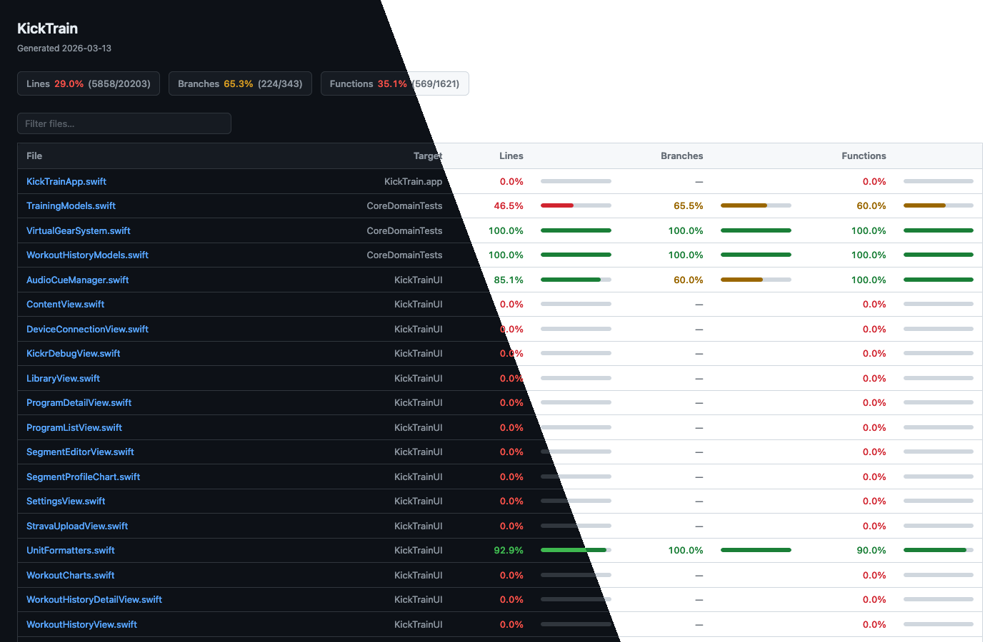
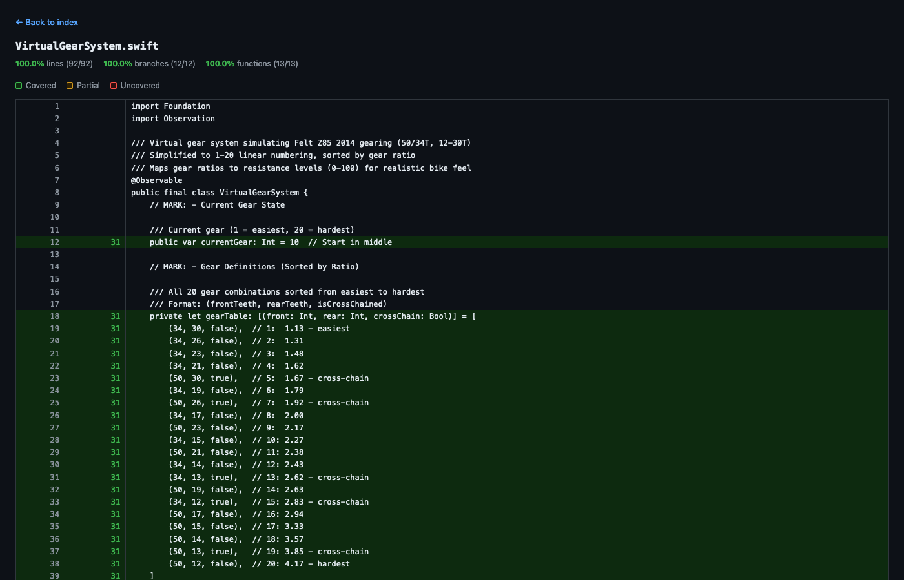

# fullcoverage

fullcoverage is a Swift CLI tool. It reads an Xcode `.xcresult` bundle. It creates a static HTML coverage report with multiple files.

It is similar to [Slather](https://github.com/SlatherOrg/slather) and [Kover](https://kotlin.github.io/kover/). It needs no extra toolchain.

The tool gets coverage data from `xcrun xccov`. It works with current Xcode xcresult bundles. It gets branch coverage from xccov `subranges`, which contain hit counts for sub-expressions.





## Features

- Coverage for lines, branches, and functions, per file and for all files.
- Finds partial branches with yellow highlights from sub-expression subranges.
- Runs xccov once per file in parallel. It shows progress and uses available CPU cores.
- Creates static HTML. It needs no server or JavaScript framework. It works offline.
- Uses a dark-mode stylesheet that switches automatically between light and dark modes.
- Provides sortable columns and a live file filter on the index page.
- Use `n` and `p` to move between uncovered lines on file pages.
- Provides a CI quality gate. It exits with a nonzero status when coverage is below a threshold.
- Writes a GitHub Actions step summary when it runs in CI.
- Creates JSON output for Codecov, Coveralls, and custom scripts.
- Creates an SVG badge for a README.
- Filters files by Xcode target and by include or exclude glob patterns.
- Groups index rows by target or CODEOWNERS team.

## Requirements

- macOS 13 or later
- Xcode or the Xcode command-line tools

## Installation

### Homebrew (recommended)

```bash
brew tap Shadester/tap
brew install fullcoverage
```

### Mint

Use [Mint](https://github.com/yonaskolb/Mint) to install Swift CLI tools:

```bash
mint install Shadester/fullcoverage
```

### curl

```bash
curl -L https://github.com/Shadester/fullcoverage/releases/latest/download/fullcoverage-macos.tar.gz \
  | tar xz -C /usr/local/bin
```

### Build from source

```bash
git clone https://github.com/Shadester/fullcoverage
cd fullcoverage
swift build -c release
cp .build/release/fullcoverage /usr/local/bin/
```

## Usage

### 1. Run tests with coverage enabled

```bash
xcodebuild test \
  -workspace MyApp.xcworkspace \
  -scheme MyApp \
  -destination "platform=iOS Simulator,name=iPhone 16" \
  -enableCodeCoverage YES \
  -resultBundlePath /tmp/MyApp.xcresult
```

You can also enable coverage in the scheme or test plan.

**Xcode UI:** Select Product > Scheme > Edit Scheme > Test > Options > Code Coverage. Select *Gather coverage*.

**`.xctestplan` file:**
```json
{
  "defaultOptions": {
    "codeCoverageEnabled": true
  }
}
```

### 2. Create the report

```bash
fullcoverage /tmp/MyApp.xcresult -o ./coverage
open ./coverage/index.html
```

### Options

```
USAGE: fullcoverage <xcresult> [options]

ARGUMENTS:
  <xcresult>             Path to the .xcresult bundle

OPTIONS:
  -o, --output <dir>     Output directory (default: coverage)
  -j, --jobs <n>         Parallel workers (default: CPU count)
  --ignore <pattern>     Glob pattern for files to exclude (repeatable)
  --include <pattern>    Glob pattern for files to include (repeatable)
  --config <file>        Config file path (default: .fullcoverage.yml)
  --title <string>       Report heading (default: fullcoverage)
  --format <format>      Output format: html (default), json, all
  --sort <order>         Sort order: name (default), coverage, lines, branches, functions
  --group-by <group>     Group rows: none (default), target, codeowners
  --codeowners <file>    Path to CODEOWNERS (auto-discovered if omitted)
  --slather-config <file> Import ignore patterns from a .slather.yml file
  --target <name>        Only include files from this Xcode target
  --min-lines <pct>      Minimum line coverage % — exits 1 if not met
  --min-branches <pct>   Minimum branch coverage %
  --min-functions <pct>  Minimum function coverage %
  --badge <path>         Write an SVG badge to this path
  --open                 Open index.html in the browser after generation
  -h, --help             Show help
```

## Config file

Add a `.fullcoverage.yml` file to your repository. This file sets default options.

```yaml
# .fullcoverage.yml
output: docs/coverage
title: "MyApp Coverage"
jobs: 16
ignore:
  - "*Tests*"
  - "*.generated.swift"
  - "*/Pods/*"
include: []
target: MyApp
sort: coverage
min_lines: 80
min_branches: 60
min_functions: 80
slather_config: .slather.yml   # optional: import ignore patterns from Slather
```

CLI flags override values in the config file. `--ignore` and `--include` add to the config lists. They do not replace the lists.

```bash
# Use config file defaults
fullcoverage App.xcresult

# Override output dir for this run
fullcoverage App.xcresult -o /tmp/coverage-preview

# Point to a non-default config
fullcoverage App.xcresult --config ci/coverage.yml
```

## CI integration

### Quality gate

Use `--min-lines` to fail the build when line coverage is below a threshold. You can also use `--min-branches` and `--min-functions`.

The tool writes the report before it exits. You can upload or inspect the report after a threshold failure.

```bash
fullcoverage App.xcresult -o coverage \
  --min-lines 80 \
  --min-branches 60

# exits 0 if thresholds are met, 1 otherwise:
# Coverage threshold failure(s):
#   • Line coverage 74.2% < 80.0% required
```

### GitHub Actions

```yaml
- name: Install fullcoverage
  run: brew install Shadester/tap/fullcoverage

- name: Run tests
  run: |
    xcodebuild test \
      -scheme MyApp \
      -destination "platform=iOS Simulator,name=iPhone 16" \
      -enableCodeCoverage YES \
      -resultBundlePath coverage.xcresult

- name: Create coverage report
  run: fullcoverage coverage.xcresult -o coverage --min-lines 80

- name: Upload report
  uses: actions/upload-artifact@v4
  with:
    name: coverage-report
    path: coverage/
```

In GitHub Actions, fullcoverage writes a Markdown coverage table to `$GITHUB_STEP_SUMMARY`. GitHub shows this table on the pull request checks page. You do not need to host or upload the HTML report.

### Xcode Cloud

Xcode Cloud runs custom shell scripts from `ci_scripts/`. Put this directory at the root of the `.xcodeproj` or `.xcworkspace`.

Xcode Cloud has no Homebrew or sudo. Install the pre-built binary in `$HOME/.local/bin`.

**`ci_scripts/ci_post_clone.sh`** runs once after the repository is cloned:

```bash
#!/bin/bash -e
mkdir -p "$HOME/.local/bin"
curl -fsSL https://github.com/Shadester/fullcoverage/releases/latest/download/fullcoverage-macos.tar.gz \
  | tar xz -C "$HOME/.local/bin"
```

**`ci_scripts/ci_post_xcodebuild.sh`** runs after xcodebuild finishes:

```bash
#!/bin/bash -e

# Only run when a test action produced an xcresult
[ -n "$CI_RESULT_BUNDLE_PATH" ] || exit 0

"$HOME/.local/bin/fullcoverage" "$CI_RESULT_BUNDLE_PATH" \
  -o "$CI_ARTIFACTS_PATH/coverage" \
  --min-lines 80
```

Make both scripts executable. Commit both scripts.

```bash
chmod +x ci_scripts/ci_post_clone.sh ci_scripts/ci_post_xcodebuild.sh
```

The tool writes the HTML report to `$CI_ARTIFACTS_PATH/coverage`. You can download it from the Xcode Cloud build detail page.

`--min-lines`, `--min-branches`, and `--min-functions` provide a quality gate in Xcode Cloud and other CI environments. `$GITHUB_STEP_SUMMARY` is unavailable in Xcode Cloud. Use `--format json` to create a machine-readable artifact.

### JSON output

Use `--format json` to write `coverage/coverage.json`. Use `--format all` to create HTML and JSON output.

```bash
fullcoverage App.xcresult --format all -o coverage
```

The JSON file contains totals for all files and metrics for each file. You can upload it to Codecov or Coveralls. You can also use it in custom scripts.

### SVG badge

Create a `coverage: 82%` badge. Commit the badge with your README.

```bash
fullcoverage App.xcresult --badge docs/coverage.svg
```

```markdown

```

## Grouping and filtering

### By target

Multi-target apps show all files in one list by default. Use `--group-by target` to add collapsible group headings and totals for each target:

```bash
fullcoverage App.xcresult --group-by target
```

### By CODEOWNERS

Use a standard `.github/CODEOWNERS` file to group files by team ownership. Files that do not match a rule appear under "Unowned":

```bash
fullcoverage App.xcresult --group-by codeowners
# auto-discovers CODEOWNERS / .github/CODEOWNERS / docs/CODEOWNERS

fullcoverage App.xcresult --group-by codeowners --codeowners path/to/CODEOWNERS
```

### Filtering

```bash
# Only files from a specific target
fullcoverage App.xcresult --target KickTrainUI

# Exclude test files and generated code
fullcoverage App.xcresult --ignore '*Tests*' --ignore '*.generated.swift'

# Narrow to a single subdirectory
fullcoverage App.xcresult --include 'Sources/Auth/*'
```

Patterns match the full file path. They use glob syntax (`*` means any sequence and `?` means one character).

### Import from a Slather config

If the project has a `.slather.yml` file, import its `ignore` list. You do not need to copy the list.

```bash
fullcoverage App.xcresult --slather-config .slather.yml
```

You can also set the option in `.fullcoverage.yml`:

```yaml
slather_config: .slather.yml
```

The CLI flag overrides this option. The tool reads only the `ignore:` key from the Slather file. It ignores other Slather-specific keys.

## How it works

```
xcresult
  │
  ├─ xcrun xccov view --report --json
  │    → file list, line/function summaries per target
  │
  └─ xcrun xccov view --archive --file <path> --json   (one call per file, parallelised)
       → per-line executionCount + subranges
```

**Branch coverage:** Consider `if isLoggedIn && hasPermission { ... }`. Swift does not check `hasPermission` when `isLoggedIn` is `false`. This is short-circuit evaluation.

Tests can run that line without testing the case where `isLoggedIn` is `true` and `hasPermission` is `false`.

Xcode tracks each sub-expression separately. It calls these items *subranges*. fullcoverage reads the counts. It uses them to estimate branch coverage.

If a sub-expression on a line is never evaluated, fullcoverage marks the line as a partial branch.

This result differs from traditional branch coverage. It still helps you find conditions that tests did not run.

The tool needs no instrumented binary or `.profdata` extraction. It reads all data from the xcresult bundle.

## Project layout

```
fullcoverage/
├── Package.swift
└── Sources/fullcoverage/
    ├── CLI.swift           # ArgumentParser entry point, all flags
    ├── Models.swift        # LineInfo, FileSummary, FileReport
    ├── Parser.swift        # xccov subprocess calls + JSON parsing
    ├── Config.swift        # .fullcoverage.yml loading
    ├── Ignore.swift        # glob-pattern matching for --ignore / --include
    ├── SlatherConfig.swift # imports ignore patterns from .slather.yml
    ├── Codeowners.swift    # CODEOWNERS parsing and path matching
    ├── Badge.swift         # SVG badge generation
    ├── GitHubSummary.swift # GitHub Actions step summary
    ├── JSONReport.swift    # Machine-readable JSON output
    ├── Resources/
    │   └── style.css
    └── HTML/
        ├── Generator.swift     # orchestrates multi-file output
        ├── IndexPage.swift     # renders index.html
        └── FilePage.swift      # renders per-file source viewer
```
